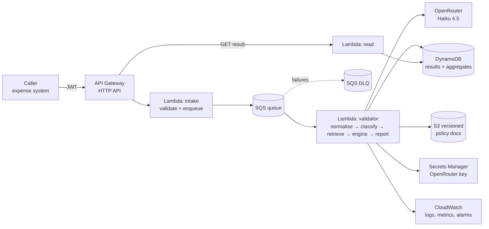

# AWS deployment design (Part 4)

A small, authenticated, mostly-serverless service. Decisions are recorded in ADR-030.

## 1. Architecture

- **API:** API Gateway **HTTP API** — cheapest managed front door, native JWT authorizer, throttling
  per client. `POST /receipts` (batch) returns `202` + IDs; `GET /receipts/{id}` returns the result.
- **Compute:** **Lambda** (Python 3.10 container image with the package). Validation is I/O-bound
  (one or two model calls, ~2–4 s) and bursty, so per-request billing beats an always-on container.
  An **SQS** queue sits between intake and the validator: it absorbs the daily peak, lets the
  model's rate limit set the pace (reserved concurrency on the worker), and retries failures, with a
  **DLQ** for receipts that keep failing.
- **State:** **DynamoDB** stores each result (keyed by receipt ID, with the policy version and
  model ID that produced it) and the cross-receipt aggregates the engine needs (ADR-016): per
  employee-date meal spend and per trip OTC spend, updated with conditional writes so concurrent
  workers cannot double-count. The LLM cache becomes a DynamoDB table keyed by the same SHA-256.
- **Logs:** **CloudWatch** structured JSON logs (receipt ID, stage, latency, tokens, cost — never
  receipt text), metrics for disposition mix, EXC-03 rate, model errors and spend, and alarms on them.

## 2. Policy documents

The nine Markdown documents live in a **versioned S3 bucket**, changed only through a pull request
that runs the test suite — including the test that checks every coded threshold against the policy
text (ADR-029), so a policy edit that changes a number fails the build until the engine is updated.
The validator loads the registry at cold start and reloads when the S3 object version changes
(checked at most every few minutes). Each result records the **policy version** it was decided under,
so any past decision can be re-explained or re-run.

## 3. Authentication and secrets

- **Callers:** Cognito **machine-to-machine** app clients (OAuth client-credentials). API Gateway's
  JWT authorizer checks the token and its scope (`receipts/write`, `receipts/read`); the client ID is
  logged for audit. Human reviewers use the same user pool with SSO.
- **OpenRouter key:** **Secrets Manager**, encrypted with a KMS key; only the worker's IAM role can
  read it; fetched at cold start and cached in memory; rotated by replacing the secret. It never
  appears in code, environment files, images or logs.

## 4. Cost — about 50,000 receipts a day

From our own run (`outputs/run_manifest.json`): 32 receipts used 62,786 input and 7,940 output
tokens and cost **$0.1025**, i.e. **≈ 1,960 input + 250 output tokens and $0.0032 per receipt**
(non-English receipts add a translation call; the average includes it).
50,000/day × 30 = **1.5 M receipts/month**.

| Item | Calculation | ≈ $/month |
|---|---|---|
| Model (Haiku 4.5: $1/M in, $5/M out) | 1.5 M × $0.0032 | **4,800** |
| Lambda | 1.5 M × 3 s × 0.5 GB = 2.25 M GB-s × $0.0000167 + requests | 40 |
| API Gateway HTTP API | ~3 M requests × $1/M | 3 |
| SQS | ~4.5 M requests × $0.40/M | 2 |
| DynamoDB on-demand | ~3 M writes + 3 M reads | 3 |
| CloudWatch logs + metrics | ~3 GB ingested + alarms | 5 |
| S3, Secrets Manager, KMS, Cognito M2M | small | 20 |
| **Total** | | **≈ 4,900** |

The model is ~98% of the bill. The cheapest lever is **prompt caching**: the classifier's system
prompt (~1,000 tokens) is identical on every call, and cached reads cost a tenth, saving about
$1,350/month. Others: batch several small receipts per call, skip the model for receipts whose
items repeat a cached description, or move to a cheaper model after re-running the evaluation.

## 5. Before production

1. **Model outage and degradation:** the queue retries with backoff; after N failures the receipt
   gets EXC-03 signals and goes to review (never a silent pass); a circuit breaker can fail over to a
   second provider. Alarms on error rate, EXC-03 rate and daily spend versus budget.
2. **Personal data:** receipts name employees, guests and officials. Encrypt at rest (KMS) and in
   transit, keep only IDs and categories in logs, set retention on results and logs, check that the
   model provider does not retain or train on submitted data, and send only the line text and
   receipt context the classifier needs.
3. **Quality monitoring:** a weekly random sample of *passed* and *flagged* receipts reviewed by
   auditors, to measure precision and missed violations at the real base rate
   ([evaluation, section 7](evaluation.md#7-the-base-rate-question)); alert when the disposition mix
   or category distribution drifts.
